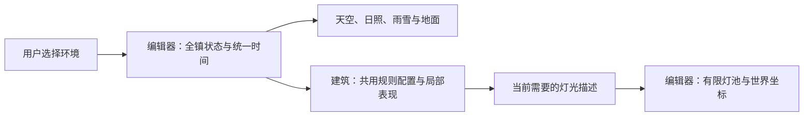

# 小镇环境与建筑协作约定

2026-10-20。本文整理用户在讨论窗口确认的规则；**确认方案不等于代码已经实现**。后续 C v2.6 已按用户授权实施环境运行层，C v2.7 在小样认可后接入真实贴合的通用积雪与部位替换，建筑专属雪造型执行中转交美术窗口；运行现状见[建筑与编辑器状态](building-status.md)，未确定事项见[待定清单](open-questions.md)。

地图统一选择环境、提供整座小镇的光照和降水；建筑响应自己的灯光、材质和装饰。大多数行为共用规则，少数表现保留建筑特点，不要求每栋建筑另做四份模型。

## 阅读入口

| 文档 | 只负责说明什么 |
| --- | --- |
| [术语](CONTEXT.md) | 时段、天气、季节、积雪及各种交付状态的含义 |
| 本文 | 已确认的通用美术规则、分工和协作方式 |
| [环境接口约定](environment-contract.md) | 目标接口的输入、调用、灯光与资源责任 |
| [建筑与编辑器状态](building-status.md) | 当前代码能做什么、哪些需要补，附源码及交付依据 |
| [待定清单](open-questions.md) | 尚未确认的产品细节、实现前还需设计的技术细节 |

后续任务先读本文，再读本任务相关章节。最新用户明确决定优先；历史提示词不能覆盖这里已经澄清的职责与状态。更新实际能力时同步更新状态表，不把目标规范改写成历史上已经完成。

## 已确认：三个独立条件

- **时段**：早晨、下午、黄昏、夜晚。
- **天气**：晴天、下雨、下雪。晴雨雪已正式接通，组合画面仍待审看。
- **季节**：建筑的季节装饰、陈设等状态，需要实际制作对应内容。冬季不自动等于下雪；具体季节内容与上线范围尚未确定。

天气和时段可以叠加；切换其中一个，不重置另外一个。积雪量独立于是否正在下雪，停雪后仍能有残雪。季节也不替用户自动切换天气；跨季节时残雪如何处理尚未讨论。

## 已确认：四时段通用美术方向

| 时段 | 全镇环境 | 通用夜灯行为 |
| --- | --- | --- |
| 早晨 | 清淡天空、略暖且较低的阳光、较长而柔和的影子；清爽，不整体泛黄 | 室外夜灯关闭，营业灯依各建筑已确认规则保留 |
| 下午 | 正常日间基准，原色清楚；太阳较高、影子较短，避免过曝 | 保持日间灯光安排 |
| 黄昏 | 天空与阳光偏暖、太阳降低、影子拉长、环境变暗，主要颜色仍可辨 | 黄昏就开始亮灯，夜灯效果低于夜晚 |
| 夜晚 | 深蓝天空、偏冷的环境光，明显区别日间；建筑和道路保持清楚可辨 | 夜灯达到正常夜间表现，局部暖光突出门口、窗户和道路附近 |

夜间基础可见度由全镇环境光保证，不要求靠每栋建筑的灯照亮全部道路。保留建筑本身颜色和已认可的局部灯光形状；避免全镇统一调色与建筑自身调色重复叠加。

以上是美术方向，尚未固定全镇精确色值、太阳角度、亮度和切换时长。樱家现有四时段响应应保留并协调；不直接改材质类型来强行统一受光方式。

## 已确认：三栋建筑的开灯安排

| 建筑 | 共用规则与保留的特点 |
| --- | --- |
| 樱家 | 白天关闭夜间暖窗／路灯效果；黄昏开启，夜晚增强。保留现有窗色、光束、光斑和照射方向，不在本次约定中重做路灯造型 |
| みつや | 保留日间营业暖光，早晨与下午共用日间表现；黄昏增强，夜晚沿用用户已认可的 night-10。门口暖光及其方向属于建筑特点 |
| AME MART 便利店 | 营业相关灯光白天保留，包括店内、冷柜和售货机；室外路灯黄昏再开。各招牌是否全天发光、夜间如何增强仍待具体确认 |

共用“黄昏开灯”不要求每盏灯颜色和亮度相同。先确认一套共用规则，再逐栋确认采用哪些规则、有哪些例外；明确认可过的部分不重复索取同一确认。沿用某个表现是明确设计选择，“尚未制作”不能悄悄当成“沿用”。

## 已确认：职责分工

| 内容 | 建筑窗口／建筑模块 | 地图编辑器／场景宿主 |
| --- | --- | --- |
| 建筑本体 | 模型、原始配色、入口、稳定编号与版本 | 创建实例、摆放、旋转、搬动、删除 |
| 环境响应 | 选择共用规则、提供配置和局部例外；维护自身材质、亮窗与装饰 | 统一环境选择、天空、日照、夜间基础光；向实例传递状态 |
| 灯光 | 灯的局部位置／目标、色彩、强度、规则和可见灯具表现；返回当前所需灯光 | 创建和复用真实光源、管理灯池与阴影、变换世界坐标；不重复计算时段强度 |
| 天气／积雪 | 适合本建筑形状的雪层、檐口滴水等局部表现 | 全镇雨雪、实际遮挡、统一积雪和融雪进度、道路及地图地面 |
| 季节 | 经过用户确认的建筑季节内容与切换表现 | 传递所选季节，不能凭字段存在就认为建筑已制作 |
| 动画与资源 | 响应宿主时间，只释放自身拥有的资源 | 唯一主循环、实际光源资源、布局变化后的环境恢复 |
| 保存 | 编号稳定，实例可以按状态恢复 | 保存、恢复及导入导出地图与环境；保护旧存档 |

这是内容归属，不自动派任务或要求新开窗口。实现任务中谁修改具体文件，仍按用户给该窗口的授权；例如已授权编辑器实现的建筑雪层可以在本任务范围内完成，但不能与建筑模块再生成一份重复效果。

共用规则只维护一份。建筑调用共用计算并结合自己的配置、例外生成表现；编辑器消费最终灯光描述时，不再乘一次黄昏／夜晚系数。共用计算如何放入现有代码属于待实现细节，不在本轮创建新框架。

## 已确认的雪景要求（实现程度见状态表）

- 以用户参考图上半张的动画轮廓与配色为主，下半张辅助理解厚度和少量起伏；可旋转、近看，有真实三维厚度。
- 三栋建筑按自身形状覆盖屋顶、雨棚、围墙、适合承雪的植物及小物；地图地面同时积雪。道路中央薄、边缘厚，厚雪遮住大部分草叶，入口仍可辨认。
- 明显但不遮蔽街区的六角雪花，缓慢飘落、轻微摆动，并尊重实体遮挡。
- 各处同时开始积雪，约 1 分钟积满；满雪转晴约 5 分钟融完，转雨约 1 分钟融完。切换连续，未融完又下雪从剩余量继续。
- 新放置、旋转、搬动、删除、撤销恢复和轮廓修改后，建筑与地面雪景正确跟随；不留下悬空雪壳。
- 保存及文件导入导出携带环境和雪量；关闭期间不推进，重新打开后继续。时段一并保存；旧布局仍可读，非法导入不能只替换一半。

后台暂停、旧布局兼容策略已由用户后续明确确认，见接口和当前交接。季节不在本轮雪景实现范围中自动新增。

## 使用与验收约定

交付分别说明：用户决定、制作完成、技术检查、正式地图接入、用户画面认可。独立预览通过不能代替地图验收；用户认可みつや night-10，也不等于已经认可全镇夜景。

每栋建筑提供稳定 ID／版本、共用规则与例外、效果覆盖表、可查看的预览和真实检查结果。未实现的内容直接标明。所有建筑仍放在各自资产文件夹，不为四时段复制四套完整模型。

正式验收需要查看同街区四时段与天气组合，并核对多实例、旋转、删除恢复和保存。这里只记录验收方向，本轮没有运行这些检查。既有编辑器 UI、人物暂停方向、独立室内方案和其他美术任务均不因本约定改变。
